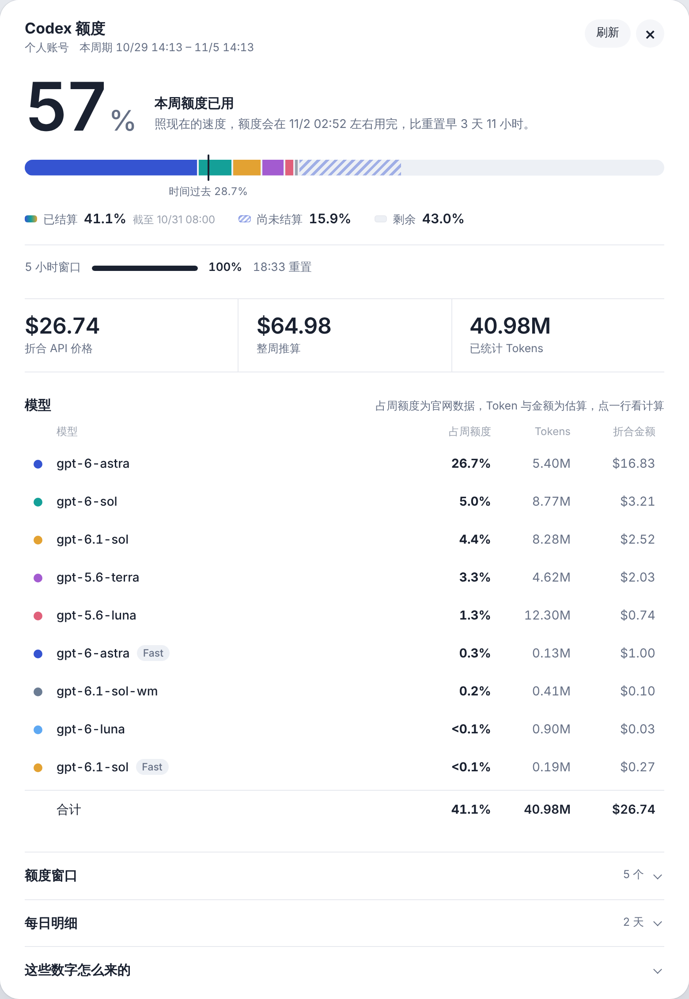
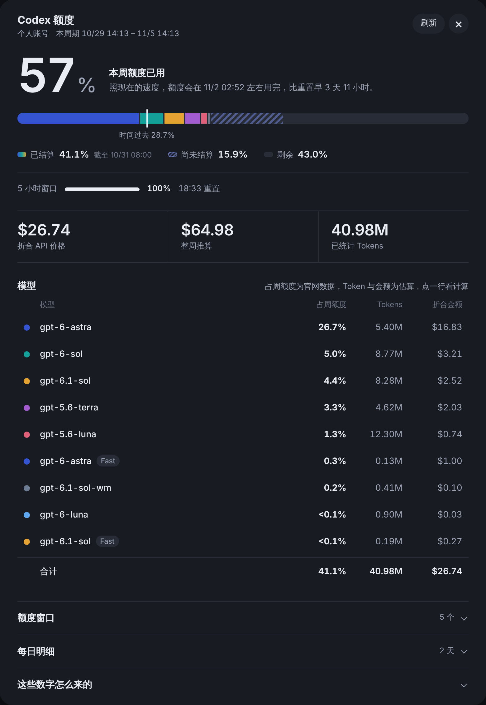

# Codex 额度透镜

在 ChatGPT 的用量页里看清 Codex 的周额度：用了多少、还剩多少、照这个速度什么时候用完，以及额度都花在了哪些模型上。

  
  

## 能看到什么

- **实时已用与官网已结算**：官网的用量历史按 UTC 整点结算，比实时数字滞后。面板把两者分开显示，差值就是还没结算的部分。
- **用量节奏**：额度条上标出本周时间已经过去多少，并按当前速度估算额度什么时候用完。
- **各模型占周额度**：直接取官网「套餐用量历史」的数据，同一模型的 Standard 与 Fast 分开列。
- **折合 API 价格**：按 OpenAI API 公开价格估算已用部分值多少钱，并推算整周。点任意模型可以看到计算过程。
- **更多细节**：5 小时窗口、历史额度窗口、用量来源（包括记忆整理这类后台任务）、每日明细。
- 支持深色模式，手机上也能正常查看。

## 安装

### Safari（Mac、iPhone、iPad）

1. 在 App Store 安装 [Userscripts](https://apps.apple.com/app/userscripts/id1463298887)。
2. 打开 Userscripts，设置一个脚本文件夹，把 `codex-quota-lens.user.js` 放进去。
3. 在 Safari 的扩展设置里启用 Userscripts，并允许它访问 chatgpt.com。

### Chrome、Edge、Firefox

安装 [Tampermonkey](https://www.tampermonkey.net/) 或 [Violentmonkey](https://violentmonkey.github.io/)，然后打开[这个链接](https://raw.githubusercontent.com/2Wren/codex-quota-lens/main/codex-quota-lens.user.js)，扩展会弹出安装页面。脚本没有用到任何扩展专有的 API，但目前只在 Safari 上测试过。

脚本里写了更新地址，发布新版本后脚本管理器会自动提示更新。

## 使用

登录 ChatGPT，打开 <https://chatgpt.com/settings/usage>，点右下角的「Codex 额度」。

## 数据来源

脚本只在你的浏览器里运行，用你当前的登录状态请求 chatgpt.com 自己的接口：

| 接口 | 用途 |
| --- | --- |
| `/backend-api/wham/usage` | 实时已用比例、窗口重置时间 |
| `/backend-api/wham/usage/plan_limit_history` | 官网「套餐用量历史」：已结算比例、各模型与来源的占比 |
| `/backend-api/wham/usage/daily-token-usage-breakdown` | 每天各模型的相对消耗 |
| `/backend-api/wham/analytics/daily-workspace-usage-counts` | 每天的 Token 合计 |
| `/backend-api/wham/usage/daily-workspace-user-token-usage-breakdown` | Team 工作区的模型级 Token |

这些都是 ChatGPT 网页自己使用的非公开接口，没有官方文档，随时可能变化。

## 估算说明

- 个人账号的每日统计只有 Token 合计。一天里用了多个模型时，脚本按各模型的费率把合计反推分配到每个模型，所以模型级的 Token 和金额是估算值。
- 金额按 OpenAI API 标准价折算，Fast 按 2.5 倍、Ultrafast 按 8 倍（Codex 订阅额度口径）。它只是等价参考，不是账单。价格表在脚本开头的 `PRICES` 里，来源是 [OpenAI API 定价](https://developers.openai.com/api/docs/pricing) 和 [Codex 速度说明](https://learn.chatgpt.com/docs/agent-configuration/speed)。
- 整周推算 = 已结算时段的金额 ÷ 同一时段的已用比例。

## 隐私

脚本不收集、不上传任何数据，只和 chatgpt.com 通信。页面底部的「导出诊断信息」会生成一段文本，邮箱、ID 等字段已经打码，只有你手动复制它才会离开浏览器。

## 出问题了

ChatGPT 改版后脚本可能失效。打开面板，点底部的「导出诊断信息」，复制内容后[提一个 issue](https://github.com/2Wren/codex-quota-lens/issues)。

## 声明

这是个人项目，与 OpenAI 没有任何关联。

## 许可

[MIT](LICENSE)，作者 Wren 和 Claude。
